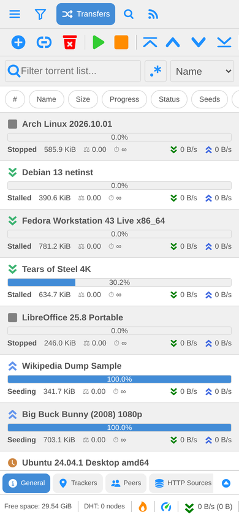
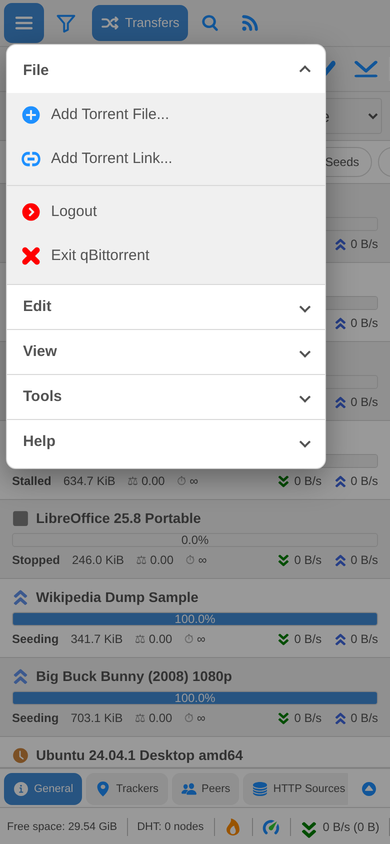
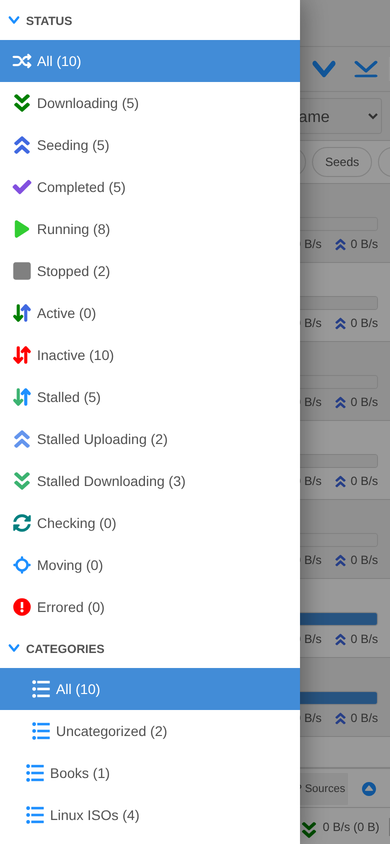
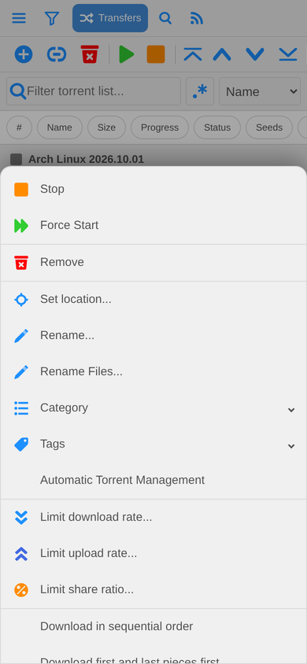
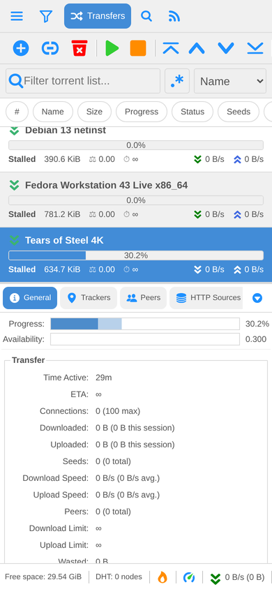
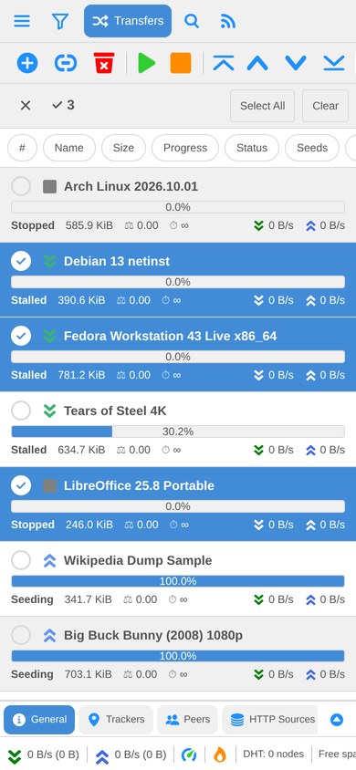
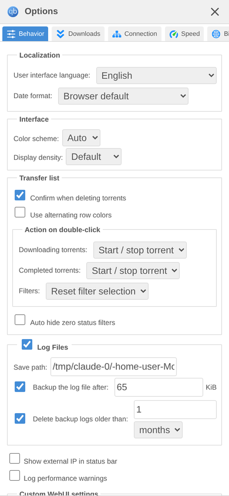

Mobile-qbit
===

The default qBittorrent WebUI (from qBittorrent **v5.2.4**), made responsive so it
works on phones and tablets as well as on desktop browsers.

On a big screen it looks and behaves exactly like the stock WebUI. Below 768px
wide (phones in portrait, or phones in landscape) it switches to a touch friendly
layout:

| Torrents | Menu | Filters | Long press |
| :---: | :---: | :---: | :---: |
|  |  |  |  |

| Details | Selecting torrents | Options |
| :---: | :---: | :---: |
|  |  |  |

What changes on a phone:

* **Menu** button (☰) opens File / Edit / View / Tools / Help as a drop-down panel.
* **Filter** button opens the status / category / tag / tracker filters as a drawer.
  Picking a filter closes it again.
* Both also work with a keyboard (e.g. on a tablet): focus moves into the panel, Tab
  stays inside it, Enter or Space picks an entry, and Escape closes it again. With
  *reduce motion* set in the system, the drawer doesn't slide.
* The toolbar is a single row you can swipe sideways. Transfers / Search / RSS / Log
  tabs sit next to the menu buttons.
* Torrents are shown as **cards** (name, progress, status, size, ratio, ETA, speeds).
  The column headers become a row of **sort buttons**: tap one to sort, tap again to
  reverse.
* **Long press** a torrent (or a filter, tracker, peer, file, RSS item, ...) for its
  context menu, shown as a bottom sheet. Entries with a ▾ expand in place. The **⋮**
  button on a torrent card opens the same menu with a tap. On touch screens a long
  press doesn't select text or bring up the browser's own menu (also on iPhones and
  iPads); text fields, the General tab and RSS articles can still be selected.
* **Select several torrents**: the ☑ button next to the torrent filter turns on the
  selection mode (on every touch screen, as there are no CTRL/SHIFT keys). Tap
  torrents to tick them, or use *Select All* / *Clear*; the toolbar buttons and the
  long press and ⋮ menus then act on all ticked torrents. ✕ leaves the selection mode.
* In **Search → Search plugins...** every plugin is a card with a switch that enables
  or disables it with a tap.
* Tap a torrent, then tap **General / Trackers / Peers / HTTP Sources / Content** to
  open its details. Tap the open tab again (or the arrow on the right) to close them.
  The button next to the arrow shows the details at full height instead of the torrent
  list, and tapping it again brings the list back.
  Trackers, peers and HTTP sources are cards with sort buttons, like the torrents.
* Every dialog fits the screen: big ones (Options, Add torrent, RSS Downloader, ...)
  open full screen, small prompts are centered and grow to fit their content.
* The **Content** tab shows every file and folder as a card, indented like the file
  tree, with its progress and priority. Tap the check box to (not) download a file,
  the arrow to open or close a folder.
* The Options window, Search, RSS, RSS Downloader, Log and all other dialogs reflow
  for narrow screens; text fields use a 16px font so iOS doesn't zoom in. The Torrent
  Creator shows its tasks as cards.
* **RSS**: the feeds fill the tab. Tap a feed for its articles and an article to read
  it; the ‹ button goes back. An article has a *Download torrent* button, as a double
  tap on it would open it instead.
* Search results, log messages and blocked IPs are cards too; light and dark themes
  both work. A search result's download button opens the download window (like a
  double tap), its **⋮** button the result's menu.

On every screen size, **Help → Check for WebUI updates** shows whether a newer
Mobile-qbit release exists and installs it with one tap (see
[Updating](INSTALL.md#updating)).

**Add to Home Screen** (Safari, Chrome) gives the WebUI the qBittorrent icon and opens
it like an app (see [Step 3](INSTALL.md#step-3-open-it-on-your-phone) of the
installation guide).

Installing
---

The WebUI is used as qBittorrent's *alternative WebUI*. Nothing needs to be built.
The short version is below; **[INSTALL.md](INSTALL.md)** has the detailed guide
(desktop app, headless `qbittorrent-nox`, Docker, opening it on the phone, updating
and troubleshooting).

1. On the computer running qBittorrent, download this repository
   (**Code → Download ZIP** on GitHub, then unzip it) or clone it:

   ```sh
   git clone https://github.com/tysonjf/Mobile-qbit.git
   ```

   Pick a permanent location; qBittorrent serves the files straight from that folder.

2. In qBittorrent open **Tools → Options → Web UI** (on macOS: *qBittorrent →
   Preferences → Web UI*):
   * make sure **Web User Interface (Remote control)** is enabled,
   * tick **Use alternative WebUI**,
   * set **Files location** to the folder you just downloaded (the one that contains
     the `private` and `public` folders, e.g. `C:\Users\you\Mobile-qbit` or
     `/home/you/Mobile-qbit`),
   * click **OK** / **Apply**.

   The same setting is also available in the WebUI itself: *Options → WebUI → Use
   alternative WebUI*.

3. Open `http://<your-pc-ip>:<port>` (port 8080 by default) on your phone and log in.
   If the browser shows the old page, reload it once.

To update later, use **Help → Check for WebUI updates** in the WebUI, or replace the
folder with the new version (or `git pull`) and reload the page. To go back to the
built-in WebUI, untick **Use alternative WebUI**.

> [!NOTE]
> The WebUI talks to qBittorrent through its Web API, so use it with
> **qBittorrent 5.2.x**. Older or much newer versions may have API differences.
> You can check your version in *Help → About*.

The WebUI follows the language set in qBittorrent, like the built-in one: for an
alternative WebUI qBittorrent loads the compiled translations from the
`translations` folder, which are included here.

Layout breakpoints
---

All responsive rules are media queries in [`private/css/mobile.css`](private/css/mobile.css),
which is loaded last by the main page and by every dialog page:

| Media query | Applies to | What it does |
| --- | --- | --- |
| `(width <= 767px), (pointer: coarse) and (height <= 500px)` | phones, portrait and landscape | phone layout |
| `(600px <= width) and (height <= 500px)` (within the phone layout) | phones in landscape | toolbar shares the top row with the tabs; the Search tab scrolls as a whole |
| `(width <= 479px)` | small phones | only the selected main tab shows its name |
| `(width <= 1100px)` | tablets, small laptops | narrower filter box and status bar |
| `(pointer: coarse)` | any touch screen | bigger menu, list and tab hit targets; a long press doesn't select text, a double tap doesn't zoom |
| `(hover: none)` | touch-only screens | no "sticky" hover highlight after a tap |
| `(prefers-reduced-motion: reduce)` | *reduce motion* set in the system | the filters drawer and the menu don't animate |

The login page has its own media queries in [`public/css/login.css`](public/css/login.css).

Changes compared to the stock WebUI
---

The first commit of this repository is the unmodified WebUI of qBittorrent v5.2.4
(`src/webui/www`), so `git diff` against it shows every change. In short:

* `private/css/mobile.css` (new): all responsive styles.
* `private/scripts/mobile.js` (new): menu button, filters drawer, selection mode,
  full height details, RSS pages, the ⋮ button of torrent cards, no browser menus
  for buttons and icons on a long press, fitting MochaUI windows into the screen,
  card row height for the virtual list option.
* `private/index.html`: menu/filter buttons, a wrapper around the toolbar buttons,
  loads `mobile.css` and `mobile.js`.
* `private/*.html` dialog pages: load `mobile.css`.
* `private/scripts/contextmenu.js`: bottom sheet mode; fixes the position of
  long-press menus on touch screens (touch events have no `pageX`/`pageY`); the click
  that can follow a long press doesn't close its menu again.
* `private/scripts/dynamicTable.js`: cells get a `data-column` attribute (used by the
  card layouts, rows of the Content tab also get their depth in the file tree); a row
  is selected on long press instead of on every touch, so scrolling the list no
  longer changes the selection; a `multiSelect` flag lets a tap toggle a row like
  CTRL+click (selection mode).
* `private/scripts/client.js`: the details panel starts collapsed on phones, panel
  sizes of the phone layout are not saved over the desktop ones.
* `public/css/login.css`: responsive login page.
* `public/manifest.webmanifest`, `public/images/mobile-*.png` (new): web app manifest
  and icons for *Add to Home Screen*. They are in `public` so that they load before
  logging in; `public/index.html` and `private/index.html` link them and set the
  `theme-color`, which `mobile.js` keeps in line with the color scheme chosen in the
  options.
* `private/images/mobile-menu.svg`, `private/images/mobile-filter.svg`,
  `private/images/mobile-select.svg`, `private/images/mobile-maximize.svg`,
  `private/images/mobile-restore.svg`, `private/images/mobile-back.svg` (new).
* `private/version.json` (new): the version of Mobile-qbit, the qBittorrent version
  it is made for and the GitHub repository its releases come from.
* `private/scripts/mobile-update.js`, `private/views/mobileupdate.html` (new): the
  updater (*Help → Check for WebUI updates*); `private/views/about.html` shows the
  Mobile-qbit version.
* `translations/*.qm` (new): compiled translations, built from the unchanged
  `translations/*.ts` sources with `tools/build-translations.py`.

Development
---

[`dev/`](dev/README.md) has a complete local test environment: a script that starts
a real `qbittorrent-nox` serving this folder, test data, and screenshot tours of every
screen at phone, tablet and desktop sizes. Read its notes before changing the WebUI.

Open work (polish and nice-to-haves) is tracked as a checklist in
[issue #1](https://github.com/tysonjf/Mobile-qbit/issues/1), including how to pick up
an item and send a pull request for it.

The lint setup is the one of qBittorrent's WebUI:

```sh
pnpm install --shamefully-hoist   # eslint.config.mjs imports packages that npm hoists
pnpm run lint                     # eslint, stylelint and html-validate
pnpm run format                   # js-beautify and prettier
pnpm run test                     # vitest
```

To try changes, point qBittorrent's *alternative WebUI* at your working copy; files
are re-read when they change, so a page reload is enough.

Releases are made by pushing a version tag; a GitHub Actions workflow publishes the
ZIP and the torrent the updater uses. See *Making a release* in
[`dev/README.md`](dev/README.md#making-a-release).

After updating the translation sources, rebuild the `.qm` files (no Qt tools needed;
the output matches `lrelease -removeidentical`, which qBittorrent uses):

```sh
python3 tools/build-translations.py
```

Browser compatibility
---

Same as upstream: the latest stable release is the upper bound.

| Browser           | Lower bound                                            |
| ----------------- | ------------------------------------------------------ |
| Chrome            | [The release from 1 year ago][Chrome-lower-bound-link] |
| Firefox           | [Latest active ESR release][Firefox-ESR-link]          |
| Microsoft Edge    | [The release from 1 year ago][MSEdge-lower-bound-link] |
| Safari            | [The release from 1 year ago][Safari-lower-bound-link] |

[Supported browsers table](https://browsersl.ist/?results#q=Chrome+%3E+0+and+last+1+year%0AEdge+%3E+0+and+last+1+year%0AFirefox+ESR%0ASafari+%3E+0+and+last+1+year)

[Chrome-lower-bound-link]: https://browsersl.ist/?results#q=Chrome+%3E+0+and+last+1+year
[Firefox-ESR-link]: https://browsersl.ist/?results#q=Firefox+ESR
[MSEdge-lower-bound-link]: https://browsersl.ist/?results#q=Edge+%3E+0+and+last+1+year
[Safari-lower-bound-link]: https://browsersl.ist/?results#q=Safari+%3E+0+and+last+1+year

License
---

The WebUI is part of [qBittorrent](https://github.com/qbittorrent/qBittorrent) and is
licensed under the GPL-2.0-or-later license with the OpenSSL exception (individual
scripts carry their own MIT or GPL headers). MochaUI and MooTools are MIT licensed.
